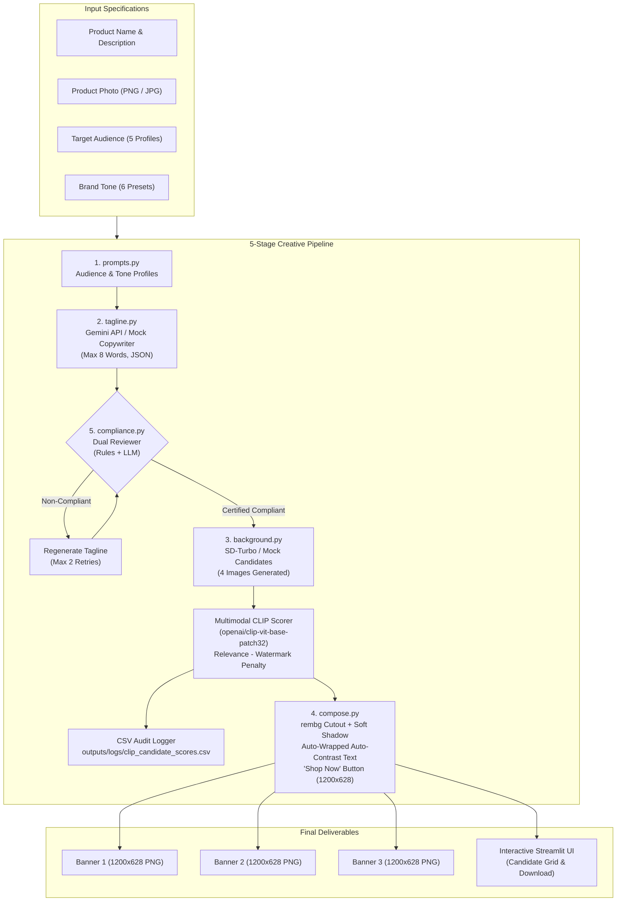

# Product Ad Creative Generator
> **Generative AI Assignment P43** &bull; Automated End-to-End Ad Creative Generation System

An agentic generative AI pipeline that ingests a product name, description, photo, target audience, and brand tone to produce **3 professional, compliant ad banners (1200x628 PNG)**. Each banner is paired with an AI-crafted tagline, an AI background scored via multimodal CLIP with watermark penalties, a soft-shadowed product cutout, an auto-contrast call-to-action button, and rigorous compliance certification.

---

## 🏛️ System Architecture



---

## 🚀 Quickstart & Setup

### 1. Prerequisites
- Python 3.10+ (tested on Python 3.10, 3.11, 3.12, 3.14)
- macOS (Apple Silicon MPS), Linux (CUDA), or Windows (CPU/CUDA)

### 2. Environment Setup
Clone the repository and navigate into the `ad_creative_generator` folder:
```bash
cd ad_creative_generator
python3 -m venv .venv
source .venv/bin/activate
pip install --upgrade pip
pip install -r requirements.txt
```

### 3. Configure `.env`
Copy the template configuration file:
```bash
cp .env.example .env
```
Default configuration runs in **Mock Mode** (zero model download required, instant testing):
```ini
GEMINI_API_KEY=your_gemini_api_key_here
MOCK_LLM=true
IMAGE_BACKEND=mock
LOG_LEVEL=INFO
```

---

## 💻 Running the Application

### Launch Streamlit Web UI
```bash
streamlit run app.py
```
Open your browser at `http://localhost:8501`. From the web interface you can:
- Input custom product names and descriptions or use the default **AquaPulse** preset.
- Switch target audiences (Students, Young Professionals, Parents, Fitness Enthusiasts, Seniors).
- Switch brand tones (Playful, Luxury, Minimal, Energetic, Emotional, Witty).
- Upload product photography with automatic background removal.
- Inspect the **CLIP Candidate Explorer** showing 4 background candidates per banner with relevance scores and watermark penalty weights.
- View real-time compliance audit badges and download 1200x628 PNG ad banners with one click.

---

## 🧪 Running Automated Tests

Run the complete 53-test automated test suite verifying tagline validation, compliance detection (50+ brands, superlatives, medical claims, endorsements), and text compositing/contrast:

```bash
pytest -v
```

All 53 unit tests pass out-of-the-box.

---

## ⚡ Running in Live Mode (Real Gemini + SD-Turbo + CLIP)

To run the pipeline with live neural models instead of mock mode:

### 1. Download Model Weights
Run the standalone preloader script:
```bash
python scripts/download_models.py
```
This script downloads and verifies:
- `stabilityai/sd-turbo` (diffusers, 1-step to 4-step ultra-fast text-to-image)
- `openai/clip-vit-base-patch32` (transformers, multimodal cosine scoring)
- `u2net` (rembg, neural product background segmentation)

### 2. Enable Live Mode in `.env`
Update your `.env` file:
```ini
GEMINI_API_KEY=AIzaSy...your_actual_key...
MOCK_LLM=false
IMAGE_BACKEND=diffusers
```
Then launch `streamlit run app.py` or execute `src/pipeline.py`.

---

## 📂 Project Structure

```
ad_creative_generator/
├── app.py                      # Interactive Streamlit UI
├── requirements.txt            # Pinned dependencies
├── .env.example                # Environment variables template
├── .gitignore                  # Git ignore rules
├── README.md                   # System guide and documentation
├── REPORT.md                   # Assignment technical report & case studies
├── src/
│   ├── __init__.py
│   ├── prompts.py              # Audience profiles, tone presets, LLM prompts
│   ├── tagline.py              # Gemini API client, validation, retry, mock copy
│   ├── background.py           # SD-Turbo generator, CLIP scorer, CSV logging
│   ├── compose.py              # rembg, soft shadow, auto-contrast, 1200x628 layout
│   ├── compliance.py           # 50+ trademark checks, superlatives, LLM review
│   └── pipeline.py             # Orchestrator running steps 1-5 end-to-end
├── scripts/
│   └── download_models.py      # Weights downloader for SD-Turbo, CLIP, and rembg
├── tests/
│   ├── __init__.py
│   ├── test_tagline.py         # Tagline constraints, word limits, banned terms
│   ├── test_compliance.py      # 50+ trademarks, false claims, medical cures
│   └── test_compose.py         # Canvas dimensions, auto-contrast, text wrap
├── assets/
│   └── sample_product.png      # AquaPulse smart water bottle sample photo
└── outputs/
    ├── banners/
    │   ├── banner_1.png        # Generated 1200x628 Banner 1
    │   ├── banner_2.png        # Generated 1200x628 Banner 2
    │   └── banner_3.png        # Generated 1200x628 Banner 3
    └── logs/
        ├── candidates/         # All 512x512 background candidates
        └── clip_candidate_scores.csv # Complete candidate audit log
```

---

## ⚖️ Limitations & Ethical Considerations

1. **Hallucination & Sub-claim Containment**: Generative LLMs can inadvertently introduce subjective superlatives or unauthorized endorsements. The dual-stage rule and LLM reviewer enforces strict FTC truth-in-advertising guidelines.
2. **Trademark Fair Use**: The system maintains an active filter of 50+ trademarks. Any direct comparison or mention is blocked unless explicit authorization is configured.
3. **Contrast & Accessibility (WCAG 2.1 AA)**: Dynamic luminance sampling ($L = 0.299R + 0.587G + 0.114B$) ensures that copy remains legible across varying generative background hues, using high-contrast color choices and soft text backing.
4. **Hardware Footprint**: In diffusers mode, SD-Turbo and CLIP run on Apple Silicon MPS or Nvidia CUDA; CPU execution is functional but significantly slower (3-5s per banner on GPU vs 30-45s on CPU). Mock mode guarantees instant deterministic testing in resource-constrained environments.

